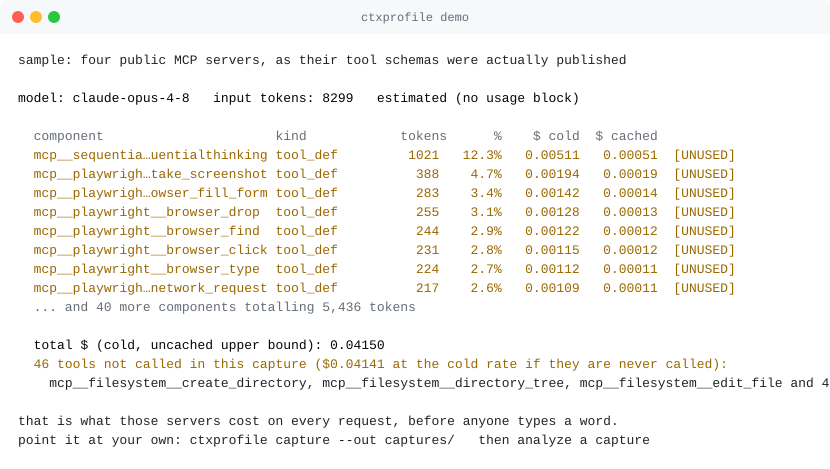

# ctxprofile

[](https://github.com/Evge14n/ctxprofile/actions/workflows/ci.yml)

**An offline CLI that costs a single LLM request per context component — and flags the tool definitions you ship on every request but never call.**

Your usage block gives you one input-token number. It does not tell you that four
MCP servers put 46 tool schemas in front of every request, that they cost about
$0.04 a call, or that the model never touched any of them.

<picture>
  <source media="(prefers-color-scheme: dark)" srcset="docs/demo-dark.svg">
  
</picture>

```
pip install git+https://github.com/Evge14n/ctxprofile
ctxprofile demo
```

That image is the output of that command, rendered from a real run by
[a committed script](tools/render_terminal_svg.py) so it cannot drift from what
the tool actually prints. Zero runtime dependencies, no API key, no proxy — it
reads a captured request and does arithmetic.

---

`ctxprofile` tells you *which part of the context* is spending the money: each individual tool schema, the system prompt, each history turn, each tool result — in tokens **and dollars** — from one captured request, with no proxy and no network.

```
model: claude-opus-4-8   input tokens: 900   exact $ (reconciled to usage)

  component                      kind            tokens      %    $ cold  $ cached
  write_file                     tool_def          238   26.4%   0.00119   0.00012  [UNUSED]
  web_search                     tool_def          224   24.9%   0.00112   0.00011  [UNUSED]
  read_file                      tool_def          183   20.3%   0.00092   0.00009
  system                         system             85    9.4%   0.00043   0.00004
  user[0]                        history            51    5.7%   0.00026   0.00003
  assistant[1]                   history            41    4.6%   0.00020   0.00002
  user[3]                        current_user       41    4.6%   0.00020   0.00002
  tool_result[2]                 tool_result        37    4.1%   0.00018   0.00002

  total $ (cold, uncached upper bound): 0.00450
  2 tools not called in this capture ($0.00231 at the cold rate if they are never called):
    web_search, write_file
```

Half the input cost of that request is two tool definitions the model never used. You pay for them on every single call.

**On real servers it gets worse.** Install four popular MCP servers — filesystem,
memory, sequential-thinking, playwright — and before you type anything your
request already carries **46 tool definitions, ~8,300 tokens, about $0.04 per
call**. Tool schemas were 99.8% of that request's input, and a single tool
(`sequentialthinking`) was the most expensive definition of all 46 — 6.6× the
average filesystem tool.
Measured, reproducible, and written up in
**[docs/case-study-mcp.md](docs/case-study-mcp.md)**.

**Across 19 published servers it is 186 tool definitions, ~52,000 tokens and
$0.26 on every request** — a quarter of a 200K context window, spent before the
user types. Two thirds of what those definitions ship is not language at all but
the JSON structure around it: a measurement in characters, so it needs no
tokenizer to believe. Run it through four real BPE tokenizers and structure's
share goes *up*, to 75–76%, because JSON punctuation fragments into tokens where
English words do not. One server was 39% of that bill.
The corpus, the method and the tokenizer probe are in
**[docs/mcp-tool-anatomy.md](docs/mcp-tool-anatomy.md)**.

**And a third of that bill cannot be referenced at all.** 16,058 of those 52,035
tokens are `$defs` entries no `$ref` reaches and JSON Schema document
annotations — bytes that cannot change a single argument the model produces,
paid on every call. `ctxprofile lint` names them, and `--write-slim` writes the
stripped request so you can watch the number fall instead of taking my word.

## Install

```
pip install git+https://github.com/Evge14n/ctxprofile
ctxprofile demo        # runs on a bundled sample of four real MCP servers
```

Python 3.11+, zero runtime dependencies. A PyPI release is pending; after it,
`pip install ctxprofile` will work directly.

## Capture real requests

Point your Claude client at the built-in proxy and it tees every non-streaming
`/v1/messages` request and response to a file — the input the rest of the
commands read. Only the bodies are stored, so your API key never lands on disk.

```
ctxprofile capture --port 8787 --out captures/
# then, in your client:
ANTHROPIC_BASE_URL=http://127.0.0.1:8787 claude -p "refactor auth.py"
```

Stdlib only, no certificate interception (plaintext localhost in, TLS out).
Streaming (SSE) responses are reassembled into a normal message, so the merged
`usage` is available for `analyze`. Captures hold plaintext prompts and output —
treat the directory as secret.

## Use

Capture one request/response pair as JSON (the raw Anthropic Messages API request, optionally with the response so costs reconcile to the real `usage`), then:

```
ctxprofile analyze capture.json
ctxprofile analyze capture.json --json           # machine-readable
ctxprofile analyze request-only.json --model claude-sonnet-5
ctxprofile compare before.json after.json        # $ delta of a prompt/tool change
```

The input is either a bare request, or `{ "request": {...}, "response": {...} }`.

`compare` shows exactly what a change costs. Drop a dead tool and see it:

```
compare (A -> B)   model: claude-opus-4-8
  total $ (cold): 0.00450 -> 0.00350   (-0.00100, -22%)

  component               Δ tokens    Δ $ cold  note
  web_search                  -224    -0.00112  removed
  ...
  dead tools: ['web_search', 'write_file'] -> ['write_file']
```

## Measure instead of estimating (optional)

The offline split is a ~4 chars/token heuristic. `--online` replaces it with a
real count for the two parts the API serializes independently of everything
else — the system prompt and each individual tool definition — by measuring each
one as a marginal against the `count_tokens` endpoint. That is the number the
dead-tool figure is built on, so it is the one worth measuring.

```
pip install "ctxprofile[online]"
export ANTHROPIC_API_KEY=...
ctxprofile analyze capture.json --online
```

```
model: claude-opus-4-8   input tokens: 900   exact $ (reconciled to usage)

  component                      kind            tokens      %    $ cold  $ cached
  write_file                     tool_def          234*  26.0%   0.00117   0.00012  [UNUSED]
  web_search                     tool_def          221*  24.6%   0.00111   0.00011  [UNUSED]
  read_file                      tool_def          180*  20.0%   0.00090   0.00009
  system                         system             85*   9.4%   0.00043   0.00004
  user[0]                        history            52    5.8%   0.00026   0.00003
  assistant[1]                   history            42    4.7%   0.00021   0.00002
  user[3]                        current_user       41    4.6%   0.00020   0.00002
  tool_result[2]                 tool_result        38    4.2%   0.00019   0.00002
  (tool block overhead)          tool_def            7*   0.8%   0.00003   0.00000

  * tokens measured with count_tokens (6 calls); unmarked rows are the ~4 chars/token estimate
  (tool block overhead) is what having any tools at all costs; removing one tool does not recover it
  on the rows it could check, the estimate ran 70% below the measured value — the unmarked rows carry that kind of error
  total $ (cold, uncached upper bound): 0.00450
  2 tools not called in this capture ($0.00228 at the cold rate if they are never called):
    web_search, write_file
```

That is a real run of the command above on `examples/capture.json`, with the
endpoint answered by the local stand-in from
[tests/test_online_http.py](tests/test_online_http.py) — the token values are
that stub's, not Anthropic's. With a key they come from the real tokenizer; the
shape and the labelling are what you get either way.

Each `*` tool row is that tool's **leave-one-out marginal** — what you stop
paying if you delete it. The shared tool-block overhead is a separate row rather
than being spread across the tools, because deleting a tool does not recover it;
folding it in would overstate every "remove this and save" figure.

Measuring part of a request also tells you something about the rest of it, so
`--online` reports how far the heuristic was from the measured value on the rows
it could check. That turns the estimate on the remaining rows from an unqualified
guess into one whose error you know the size and direction of.

Counting tokens is free but rate-limited, and this costs roughly one call per
tool. `--online-max-calls` (default 64) refuses the run before spending
anything if a request would exceed it. Message and history rows stay estimated —
differencing them out would cost a call per turn for a number that changes every
request anyway. The core CLI is unaffected: no key, no network, no dependencies.

## Find out what keeps breaking your cache

A cache hit costs 0.1× and a rebuild costs 1.25×, so a prompt edit that lands high
in the prefix is expensive in a way the bill never spells out. The usage block
tells you a rebuild happened; it cannot tell you what caused it. Two consecutive
captures can, because the cause is the first place their prefixes differ.

```
ctxprofile churn captures/*.json
```

```
churn   model: claude-opus-4-8   4 captures   1 rebuilds   ttl assumed 5m

  when                 cause                               rebuilt   excess $
  2026-08-09T11:43:32  system (system)                        1840    0.01058

  total excess over cache reads: 0.01058
```

Appending a message is not a divergence — a conversation that only grew keeps its
cached prefix, so the common case is correctly silent. When nothing changed, this
refuses to invent a culprit: an unchanged prefix after longer than the TTL is
reported as `ttl expiry`, and one inside the TTL as `unexplained`. Switching model
gets its own label, because caches are model-scoped.

The excess column is the honest number: what the rebuild cost *above* what a hit
would have cost, not the whole write. Needs captures that carry `captured_at` and
a `usage` block — which is what `ctxprofile capture` writes.

## Lock the context floor and gate it in CI

Treat your static context — the system prompt and the tool set you ship on every
request — like a lockfile. Commit a baseline, and let CI fail any PR that raises
it or adds a tool without a deliberate re-lock.

```
ctxprofile lock --from captures/agent-turn.json    # writes .ctxprofile.lock
ctxprofile ci --lock .ctxprofile.lock captures/*.json
```

```
FAIL captures/agent-turn.json
  - static floor +410 tokens over lock (allowed +0)
  - new tool(s) not in lock: web_search
```

Accepting a rise is a deliberate one-line commit: re-run `ctxprofile lock` and
commit the new `.ctxprofile.lock`.

You can also gate absolute cost and dead tools with a budget:

`ctxbudget.toml`:

```toml
max_input_tokens = 20000
max_total_usd_cold = 0.05
max_dead_tools = 0
```

Drop either into GitHub Actions; it exits `1` on any breach, so the step blocks the PR:

```yaml
- run: ctxprofile ci --budget ctxbudget.toml --lock .ctxprofile.lock captures/*.json
```

Add `--format github` to print a markdown summary you can post as a PR comment.

Honest scope: the lock covers the **static floor** — the system prompt, the tool
definitions, and the set of tools you ship — which lives in your repo. It does
not lock per-request cost (RAG chunks, history, tool results); that is not in the
repo and moves on every call. The gate fires on the delta of a stable estimator,
so the estimator's bias cancels.

## Audit MCP-server tool bloat across a corpus

Single-request dead-tool detection is noisy — one request calls a couple of
tools and everything else looks idle. The signal is a **corpus**: point
`mcp-audit` at your tool definitions plus a set of `claude -p` / Agent SDK JSONL
traces, and it groups the wasted tokens by MCP server.

```
ctxprofile mcp-audit --defs request.json --traces runs/*.jsonl
```

```
mcp-audit   model: claude-opus-4-8   window: 3 model calls
  server                     tools  tok/req  calls  $/req cold
  mcp__ruflo                     2      130      0     0.00065
  mcp__files                     1       49      2     0.00024
  (local)                        1       40      1     0.00020

  mcp__ruflo: 130 tok/req, 0 calls in 3 model calls — $0.00065 shipped every request
  [window: 3 model calls — a rarely used tool can look unused in a short window]
```

`mcp-audit` takes `--online` too, which measures each tool schema instead of estimating it — the same flag and the same `--online-max-calls` guard as `analyze`.

`--defs` is a raw request (it carries the tool schemas, so the per-tool token estimate is grounded in the real schema text);
`--traces` are SDK or `claude -p --output-format stream-json` transcripts (they
carry the call counts). It reports a call **rate over a stated window**, never a
boolean "dead" — a tool used once a week looks unused in a short trace.

## Delete the bytes nothing can reference

`mcp-audit` finds tools you never call. `lint` finds weight inside the tools you
*do* call: schema that no tool call can reference, so removing it cannot change
a single argument the model produces.

```
ctxprofile lint request.json
```

```
lint   model: claude-opus-4-8   tool definitions: 52035 tok (estimated)

  tool                            check                   tok  what
  mcp__notion__AP…reate-a-comment unreferenced-defs       630  richTextRequest, pa…entRequest (+6 more)
  mcp__notion__API-delete-a-block unreferenced-defs       630  richTextRequest, pa…entRequest (+6 more)
  mcp__notion__AP…-block-children unreferenced-defs       630  richTextRequest, pa…entRequest (+6 more)
  ... and 152 more (--top 0 for all, --json for the full list)

  schema-meta in 131 tools, unreferenced-defs in 24 tools
  removable: 16058 tok of 52035 (30.9%) — $0.08029 per request, cold
  nothing a tool call can reference: schema metadata and definitions no $ref reaches
  [per-finding tokens are individual deltas; they need not sum to the total]
```

That run is the [19-server corpus](examples/mcp-survey.json) behind the
[tool-anatomy study](docs/mcp-tool-anatomy.md): **31% of the whole tool-definition
budget is weight no tool call can reach.** Almost all of it is one pattern —
Notion generates its tool schemas from an OpenAPI document and copies the shared
`$defs` registry into every tool, so `API-get-user` (one string parameter) ships
nine definitions describing rich text, page parents and block objects, and
references none of them.

Two checks, both restricted to things that are *provably* free:

| check | what it flags | why removal is safe |
| --- | --- | --- |
| `unreferenced-defs` | entries in `$defs` / `definitions` that no `$ref` reaches from the schema root, transitively | nothing can point at them, so no argument can depend on them |
| `schema-meta` | `$schema`, `$id`, `$comment`, `$anchor` | JSON Schema document annotations: they describe the schema, not the arguments |

A schema carrying a `$dynamicRef`, or a `$ref` this linter cannot resolve, has its
definitions left alone rather than guessed at.

Deliberately **not** flagged: `additionalProperties` (7.2% of the corpus, but it
changes validation under strict tool use), `default`, `title`, `examples`. The
model can read those, so dropping them is a judgement call rather than a free win.

`--write-slim out.json` writes the request with the removable weight stripped, so
you can check the claim instead of taking it:

```
ctxprofile lint request.json --write-slim slim.json
ctxprofile analyze slim.json          # the total drops by exactly what lint promised
```

A test asserts that round trip, so the promise cannot drift from the arithmetic.
`--online` measures the saving against `count_tokens` instead of estimating it —
three calls: the empty-tools floor, the full block, the slimmed block.

## Use it from an agent (MCP server)

ctxprofile ships an optional MCP server, so a Claude agent can profile its own
requests. Install the extra and register it:

```
pip install "ctxprofile[mcp]"
```

Then add it to your MCP client (e.g. Claude Code):

```json
{ "mcpServers": { "ctxprofile": { "command": "ctxprofile-mcp" } } }
```

It exposes three tools — `analyze_request` (cost a captured request per
component), `audit_mcp_servers` (dead-tool cost by server) and
`lint_tool_schemas` (weight no tool call can reference), so an agent can lint the
MCP schemas it is itself carrying. The core CLI stays dependency-free; only this
optional server needs `mcp`.

### Measure your own MCP servers

The same extra ships a collector that connects to the servers in your MCP client
config, reads their real tool schemas, and writes a request you can analyze:

```
python tools/collect_mcp_tools.py your-mcp-config.json -o mine.json
ctxprofile analyze mine.json
```

That is how the numbers in the [case study](docs/case-study-mcp.md) and the
[anatomy survey](docs/mcp-tool-anatomy.md) were produced. To see what your own
definitions are *made of* rather than what they cost:

```
python tools/tool_anatomy.py mine.json
ctxprofile lint mine.json
```

## What it does

- **Per-component dollars.** Splits the request into `system`, one row **per named tool**, `history`, `tool_result`, and `current_user`, and prices each with the standard Claude rates. Existing tools count tokens; the cost is what you actually pay.
- **Dead-tool detection.** Any tool defined in `tools[]` that never appears in an assistant `tool_use` block is flagged `[UNUSED]`, with the dollars it wastes on every request. Removing an unused tool is often the single cheapest large saving in an agent setup.
- **Cold vs cached.** Shows each component at the cold input rate and at the 0.1× prompt-cache read rate, so you can see what caching is (or isn't) buying you.
- **Exact when it can be.** With a `usage` block present, the total and the dollars are exact; the per-component split is reconciled to that billed total. Without one, everything is a labelled estimate.

## How the split is computed

Tokens per component come from a stable offline heuristic (~4 chars/token). That estimate is only used for the **proportional** split; when the capture includes a real `usage` block, `ctxprofile` scales the split so the components sum to the exact billed input and prices the exact total. So the headline dollars are real; the per-component division is a grounded estimate, marked as such.

With `--online`, the system prompt and every tool definition are measured against `count_tokens` instead of estimated, and only the remaining components share out what the billed total has left. Measured rows are marked `*` in the table and carry `"exact": true` in `--json`.

## What it can and can't tell you

Owning the boundary is the point. Numbers are labelled by how much you can trust them.

| Signal | Confidence |
| --- | --- |
| Total input $ (capture has `usage`) | Exact — from the billed usage block |
| Blended cache $ (usage has a cache split) | Exact — from the cache buckets |
| Which tools are defined vs. actually called | Exact — structural, over this capture's request **and** its response |
| Dead-tool token cost | Estimated tokens (~4 chars/token, reconciled to the billed total); **measured** with `--online`; list-price rate |
| Per-component token split | Estimate — a stable ~4 chars/token heuristic, reconciled to the exact total |
| System and per-tool tokens with `--online` | Measured — a `count_tokens` marginal, not a heuristic |
| Message / history split with `--online` | Still an estimate — but `--online` reports the estimator's measured error, so you know its size and direction |
| Static-floor regression (`lock`) | Exact — the delta of the same estimator, so its bias cancels |
| Per-request dynamic cost (history, RAG, tool results) | Not locked — it moves per call and isn't in your repo |
| Cache-churn attribution | Attributed to the first diverging component; a rebuild with no divergence is labelled a TTL expiry or left unexplained |
| Unreachable schema weight (`lint`) | Exact — structural: a definition no `$ref` reaches cannot affect a tool call. Its **token** cost is estimated, or measured with `--online` |

The full reasoning is in [docs/design.md](docs/design.md).

## Prior art

Context attribution is not a new idea. `context-lens` and `ContextSpy` are live proxies with dashboards that break a request into components; `context-profiler` is an offline CLI for token distribution. `ctxprofile` is deliberately narrow and complementary: it is offline (no proxy to run), it reports **dollars** rather than only tokens, it splits **per individual tool** rather than one "tool definitions" blob, and it names **dead tools**. Use a proxy dashboard for a live feed; use `ctxprofile` in a script or CI to cost and lint a single captured request.

## Roadmap

- RAG-chunk attribution when retrieved context is tagged.
- More `lint` checks, as long as each one stays provably free to apply.

## License

MIT © Yevhen Martynyuk
