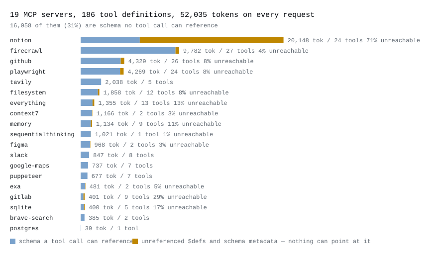

# What an MCP tool definition is actually made of

*19 public MCP servers, 186 tool definitions, measured 2026-08-09.*

The advice you hear about tool definitions is "write shorter descriptions." This
measures where the bytes really go across a large sample of published servers,
and the advice turns out to be aimed at the smaller half of the problem.

Reproduce it:

```
python tools/collect_mcp_tools.py your-config.json -o mine.json
python tools/tool_anatomy.py mine.json
python tools/bpe_probe.py mine.json     # needs tiktoken
ctxprofile analyze mine.json
ctxprofile lint mine.json
python tools/render_survey_chart.py mine.json -o mine.svg --theme light
```

The corpus used here is committed as
[`examples/mcp-survey.json`](../examples/mcp-survey.json), so the numbers below
can be recomputed without installing anything.

## The bill

```
19 servers   186 tool definitions   ~52,035 tokens   $0.2602 per request
  that is 26% of a 200K context window and 5% of a 1M one, spent before the user types
  and 31% of it is schema no tool call can reference
```

Every one of those tokens ships on **every** request for as long as the servers
are installed, whether the session touches them or not.

<picture>
  <source media="(prefers-color-scheme: dark)" srcset="survey-dark.svg">
  
</picture>

*Generated from the committed corpus by
[`tools/render_survey_chart.py`](../tools/render_survey_chart.py), so the picture
and the numbers come from the same data.*

## Where the bytes are

This part needs no tokenizer, so it is exact rather than estimated:

| | characters | share |
| --- | ---: | ---: |
| Language a model reads (descriptions, titles, wherever they appear) | 58,857 | 31% |
| JSON structure carrying it (`type`, `properties`, `required`, `$defs`, braces) | 133,605 | **69%** |

Roughly two thirds of what a tool definition ships is not language. It is the
scaffolding around the language.

### Does that survive a real tokenizer?

The estimate above applies one ratio to everything, which cannot be right for two
kinds of text at once. The obvious objection is that repetitive JSON should
compress *better* than English, which would shrink structure's share.

I assumed that too. It is backwards.

Claude's tokenizer is not public, so this cannot say what Claude counts. But the
objection rests on a property of BPE tokenizers, and several of those are public.
Running this corpus through four of them
([`tools/bpe_probe.py`](../tools/bpe_probe.py)):

| encoding | prose chars/token | structure chars/token | ratio |
| --- | ---: | ---: | ---: |
| cl100k_base | 4.83 | 3.56 | 0.74× |
| o200k_base | 4.82 | 3.55 | 0.74× |
| p50k_base | 4.41 | 3.20 | 0.72× |
| r50k_base | 4.40 | 3.20 | 0.73× |

JSON structure is *less* compressible than prose, not more — consistently, across
vocabularies from 50k to 200k. The reason is visible one token at a time: English
words arrive whole (`Read`, ` the`, ` complete`, ` contents`), while JSON
punctuation shatters into fragments (`{"`, `type`, `":`, `" "`, `object`, `",`).

So the flat estimate was **understating** structure. Under these tokenizers its
share is **75–76%**, not the 69% the character split gives. Per tool, the median
ratio is 0.69× and the highest of 168 is 1.06× — none of them approach the 2.28×
that would have been needed to reverse the finding.

For completeness, here is what the flat estimate implied before it was measured —
the row that actually applies is now the top one, and every row below it was the
hypothetical that turned out not to happen:

| JSON chars/token | structure tokens | prose tokens | structure share |
| ---: | ---: | ---: | ---: |
| 4.0 (the estimator) | 33,402 | 14,715 | 69% |
| 6.0 | 22,268 | 14,715 | 60% |
| 8.0 | 16,701 | 14,715 | 53% |
| 10.0 | 13,361 | 14,715 | 48% |
| 12.0 | 11,134 | 14,715 | 43% |

## A third of it is unreachable

Splitting prose from structure asks where the bytes are. A sharper question is
whether the bytes can do anything at all.

`ctxprofile lint` answers it with two structural checks. A `$defs` entry that no
`$ref` reaches — transitively, from the schema root — cannot influence any
argument the model produces: nothing can point at it. `$schema`, `$id`,
`$comment` and `$anchor` are JSON Schema document annotations, describing the
schema rather than the arguments. Both are free to delete in the strict sense
that no tool call can tell the difference.

Across the same 186 definitions:

| check | tools affected | tokens |
|---|---|---|
| `unreferenced-defs` | 24 | 14,274 |
| `schema-meta` | 131 | 1,784 |
| **removable in total** | | **16,058 of 52,035 — 30.9%** |

The per-check rows are individual deltas — what each check alone would remove —
so they need not add up to the total, which is the one all-at-once measurement.

That is **$0.0803 of the $0.2602 per request**, paid on every call, for bytes
that cannot change a single argument.

Almost all of it is one pattern. Notion generates its tool schemas from an
OpenAPI document and copies the shared `$defs` registry into every tool.
`API-get-user` takes one string — `user_id` — and ships nine definitions
describing rich text, page parents, sort objects and block objects. It
references none of them. Eighteen of Notion's twenty-four tools reference no
definition at all; the remaining six use between one and four of the nine.

This is not a criticism of writing schemas by hand. It is what code generation
does when the generator has no reason to know that its output is priced per
request.

### Checking it rather than trusting it

`--write-slim` writes the request with the removable weight stripped; running
`analyze` on both files shows the total falling by exactly the promised amount,
and a test in the repo asserts that round trip. The slimmed corpus was also
checked for dangling `$ref` targets and for any change to `type`, `properties`,
`required` or `additionalProperties` — there were none.

Three further candidates were measured and deliberately **not** flagged:
`additionalProperties` (3,728 tokens, 7.2% — but it changes validation under
strict tool use), `default` (318) and `title` (108). The model can read those,
so dropping them is a judgement call rather than a free win, and a linter that
mixes the two kinds of advice is worth less than one that does not.

## The cost is not spread evenly

| server | tools | tokens | $/req | tok/tool | prose |
| --- | ---: | ---: | ---: | ---: | ---: |
| notion | 24 | 20,148 | 0.1007 | 839 | 11% |
| firecrawl | 27 | 9,782 | 0.0489 | 362 | 34% |
| github | 26 | 4,329 | 0.0216 | 166 | 26% |
| playwright | 24 | 4,269 | 0.0213 | 177 | 49% |
| tavily | 5 | 2,038 | 0.0102 | 407 | 53% |
| filesystem | 12 | 1,858 | 0.0093 | 154 | 59% |
| everything | 13 | 1,355 | 0.0068 | 104 | 41% |
| context7 | 2 | 1,166 | 0.0058 | 583 | 90% |
| memory | 9 | 1,134 | 0.0057 | 126 | 33% |
| sequentialthinking | 1 | 1,021 | 0.0051 | 1021 | 79% |
| figma | 2 | 968 | 0.0048 | 484 | 59% |
| slack | 8 | 847 | 0.0042 | 105 | 48% |
| google-maps | 7 | 737 | 0.0037 | 105 | 34% |
| puppeteer | 7 | 677 | 0.0034 | 96 | 44% |
| exa | 2 | 481 | 0.0024 | 240 | 69% |
| gitlab | 9 | 401 | 0.0020 | 44 | 45% |
| sqlite | 5 | 400 | 0.0020 | 80 | 30% |
| brave-search | 2 | 385 | 0.0019 | 192 | 71% |
| postgres | 1 | 39 | 0.0002 | 39 | 29% |

- **notion is 39% of the whole bill** from 13% of the tools.
- The 18 priciest definitions — 10% of them — are 34% of the cost.
- Median definition: 156 tokens. Largest: 1,541
  (`mcp__notion__API-update-page-markdown`). A 10× spread.

Tool count tells you almost nothing. `gitlab` ships 9 tools for 401 tokens;
`sequentialthinking` ships **one** for 1,021.

## Two different ways to be expensive

The `prose` column separates them, and they need opposite fixes.

**Schema-heavy — notion, 11% prose.** Its largest tool pairs a 280-character
description with a 5,791-character schema: `$defs`, nested optional objects,
`additionalProperties`, per-field `format` and `enum`. This is the shape you get
from generating tools out of an OpenAPI spec. Shortening the description saves
5% of that tool. The schema is the other 95%.

**Prose-heavy — sequentialthinking, 79% prose, one tool, 1,021 tokens.** Its
description is a manual: when to use the tool, how to think about revisions,
worked guidance. That is a deliberate design — the description *is* the feature —
but it is paid on every request, including every request that never thinks.

Same symptom, opposite causes. A single "write shorter descriptions" rule helps
one and does nothing for the other.

## What this suggests

For server authors, in rough order of leverage:

1. **Ship only what a tool call can reference.** A third of this corpus fails
   that test — nearly all of it a shared `$defs` registry copied into tools that
   reference none of it. `ctxprofile lint` names the entries; it is the one item
   on this list with no trade-off attached.
2. **Look at schema surface before description length.** Flattening `$defs`,
   dropping `additionalProperties: false` where it changes nothing, and not
   declaring optional fields nobody sets, all move the bigger number.
3. **Splitting one tool into many is not free.** Every split repeats the whole
   JSON envelope.
4. **A long description can be right** — but it should be paying for itself on
   every request, not just the ones that use the tool.

For anyone installing servers: the concentration is the lever. One server was
39% of this bill. Removing the servers a session never touches beats trimming the
ones it does — which is what `ctxprofile analyze` and `mcp-audit` are for.

## What this is not

- **Token counts are estimated, character counts are exact.** Everything in
  tokens or dollars uses the ~4 chars/token heuristic and inherits its error.
  The character split, the ratios between servers, and the concentration figures
  do not depend on it. `analyze --online` measures instead of estimating, and
  was not used here because it needs an API key.
- **The BPE probe is not Claude's tokenizer.** It answers a narrower question —
  whether JSON compresses better than prose, and by how much — on four public
  vocabularies that agree with each other to within 0.02×. Treat it as strong
  evidence about the *direction and rough size* of the effect, not as a token
  count for any Anthropic model. The dollar figures in this document still come
  from the flat estimate, so they are, if anything, low.
- **19 servers is a sample, not the ecosystem.** They were picked as widely
  installed public npm packages, which biases toward mature, well-documented
  servers. A twentieth (sentry) refused to start without real credentials and is
  absent; that omission is why `collect_mcp_tools.py` exits non-zero on a partial
  collection rather than letting it look complete.
- **Placeholder credentials were used.** Servers that validate credentials at
  startup rather than at call time are underrepresented.
- **Schemas change.** This is one date. The scripts are committed so the
  measurement can be repeated rather than trusted.
- **This measures what a server advertises**, which is what a client serializes
  into `tools[]`. A client that rewrites or filters definitions changes the bill;
  the `mcp__server__tool` prefixes here follow the Claude Code convention.
